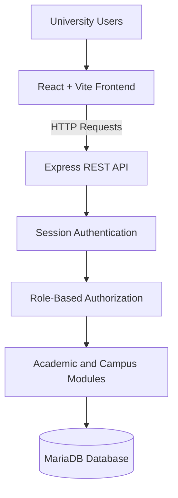

# 🎓 University ERP System

A full-stack **University Enterprise Resource Planning (ERP) System** designed to centralize academic, administrative, student, and campus operations in one web application.

The platform combines a React-based frontend, a Node.js and Express backend, and a MariaDB relational database. It includes role-aware access controls, session-based authentication, and dedicated workflows for different university user roles.

<p align="center">
  <strong>React · Vite · Node.js · Express · MariaDB</strong>
</p>

<p align="center">
  <a href="https://github.com/Anshul-sys32/UNIVERSITY_ERP_SYSTEM">Repository</a> ·
  <a href="https://github.com/Anshul-sys32/UNIVERSITY_ERP_SYSTEM/issues">Report an Issue</a>
</p>

---

## 📌 Overview

Universities manage large amounts of academic and administrative information across departments. When these workflows are separated into disconnected systems, maintaining consistency, controlling access, and managing records becomes more difficult.

The University ERP System aims to bring these operations together through a centralized application with role-based navigation, server-side authorization, and a relational database.

The project follows a separated frontend/backend architecture, making it easier to maintain the user interface, backend business logic, and database independently.

## ✨ Key Features

### 👥 Multi-role access

The backend recognizes the following user roles:

- **Student** — student-facing academic and campus services.
- **Faculty** — faculty-related academic workflows.
- **Employee** — employee and operational workflows.
- **Administrator** — administrative management and access configuration.
- **Librarian** — library-related operations.
- **Accountant** — accounting-related operations.
- **Merchant** — merchant and wallet-related workflows.

Available functionality and navigation are governed by server-side authorization policies.

### 🎓 Academic and student management

The backend contains dedicated modules for student records, academic information, and student-facing workflows, including:

- Student profile and dashboard data
- Course and timetable information
- Attendance and assignment-related workflows
- Examination administration and results
- Academic notices and notifications
- Student finance and library-related services

### 🏫 Campus and operational services

The backend also separates several campus and operational workflows into dedicated route modules, including:

- Campus and hostel-related operations
- Research-related workflows
- Library and accounting operations
- Placement-related services
- Employee and faculty data management
- Reports and administrative configuration

The exact operations available to each account depend on its assigned role and access policies.

### 🔐 Authentication and security

The backend implements several security mechanisms:

- Username and password authentication
- Password hashing using `bcryptjs`
- Server-managed sessions stored in MariaDB
- HTTP-only session cookies
- CSRF protection
- Role-based authorization middleware
- Configurable CORS origin restrictions
- Rate limiting for authentication endpoints
- Parameterized database queries
- Audit logging middleware
- Session expiration and logout handling

Public registration is restricted to eligible student records already present in the database.

### ⚙️ Configurable backend

The server supports environment-based configuration for the application port, database connection, session secret, frontend origins, and production mode.

A health endpoint is also available at `/health` for basic server availability checks.

---

## 🧰 Technology Stack

| Layer | Technologies |
|---|---|
| Frontend | React 19, Vite 6 |
| Routing | React Router DOM 7 |
| Styling | Tailwind CSS 3, PostCSS, Autoprefixer |
| Backend | Node.js, Express 5 |
| Database | MariaDB |
| Authentication | Express Session, bcryptjs |
| Security | CSRF protection, CORS, express-rate-limit |
| Session persistence | MariaDB-backed session store |
| Testing | Node.js test runner, Supertest |

---

## 🏗️ Architecture

The application uses a three-layer architecture.



**Request flow:**

1. A user interacts with the React frontend.
2. The frontend sends requests to the backend.
3. The backend validates the user's session and authorization.
4. The relevant route module executes the requested operation.
5. Data is read from or written to MariaDB.
6. The backend returns the result to the frontend.

The backend is responsible for enforcing access controls; hiding a page or navigation item in the frontend alone is not an authorization mechanism.

---

## 📂 Project Structure

```text
UNIVERSITY_ERP_SYSTEM/
├── backend/
│   ├── index.js
│   ├── app.js
│   ├── db.js
│   ├── sessionStore.js
│   ├── middleware/
│   │   ├── csrf.js
│   │   ├── roleAccess.js
│   │   └── auditLog.js
│   ├── routes/
│   │   ├── students.js
│   │   ├── studentData.js
│   │   ├── facultyData.js
│   │   ├── employeeData.js
│   │   ├── operationsData.js
│   │   ├── academicData.js
│   │   └── examAdmin.js
│   └── package.json
│
├── frontend/
│   ├── src/
│   │   ├── App.jsx
│   │   └── pages/
│   │       └── AppRoutes.jsx
│   ├── package.json
│   └── vite.config.js
│
└── README.md
```

*This is a simplified overview of the main application files. Additional route modules, components, and configuration files are present in the repository.*

---

## 🚀 Getting Started

Follow these instructions to run the application locally.

### Prerequisites

Install the following before proceeding:

- **Node.js** with npm
- **MariaDB Server** (MySQL-compatible database)
- Git
- A code editor such as Visual Studio Code

Verify your installations:

```bash
node --version
npm --version
git --version
mariadb --version
```

### 1. Clone the repository

```bash
git clone https://github.com/Anshul-sys32/UNIVERSITY_ERP_SYSTEM.git

cd UNIVERSITY_ERP_SYSTEM
```

### 2. Configure the database

Start your MariaDB server and create a dedicated application database and user.

Log in to MariaDB as an administrator:

```sql
CREATE DATABASE university_erp
  CHARACTER SET utf8mb4
  COLLATE utf8mb4_unicode_ci;

CREATE USER 'university_erp_app'@'localhost'
  IDENTIFIED BY 'replace-with-a-strong-password';

GRANT ALL PRIVILEGES ON university_erp.*
  TO 'university_erp_app'@'localhost';

FLUSH PRIVILEGES;
```

The database schema and any required initial records must be set up using the database setup files or migrations provided by the project, if available. Complete that step before starting the application.

### 3. Configure the backend

Navigate to the backend directory and install its dependencies:

```bash
cd backend
npm install
```

Create a `.env` file inside `backend/`:

```env
PORT=5000
NODE_ENV=development

FRONTEND_ORIGIN=http://localhost:5173

SESSION_SECRET=replace-with-a-long-random-secret

DB_HOST=localhost
DB_PORT=3306
DB_USER=university_erp_app
DB_PASSWORD=replace-with-a-strong-password
DB_NAME=university_erp
DB_CONNECTION_LIMIT=5
```

Generate a secure session secret on Linux:

```bash
openssl rand -base64 48
```

Copy the generated value into `SESSION_SECRET`.

**Important:** Keep `.env` files and database credentials private. Never commit real passwords or production secrets to GitHub.

### 4. Start the backend

From the `backend/` directory:

```bash
npm start
```

The server should start at:

```text
http://localhost:5000
```

Check the health endpoint:

```bash
curl http://localhost:5000/health
```

A successful response should look like:

```json
{
  "status": "ok"
}
```

### 5. Start the frontend

Open a second terminal:

```bash
cd UNIVERSITY_ERP_SYSTEM/frontend

npm install
npm run dev
```

Vite will display the local development URL in the terminal, typically:

```text
http://localhost:5173
```

If your frontend API configuration uses a different backend URL, update it to match the server address and port configured above.

Keep both the frontend and backend running while using the application.

---

## 🧪 Testing

The backend provides a test script using Node.js's built-in test runner.

From the backend directory:

```bash
npm test
```

To run the frontend linter:

```bash
cd frontend
npm run lint
```

To create a production frontend build:

```bash
npm run build
```

Vite generates the production build in the frontend's `dist/` directory.

---

## 🔌 Backend API Overview

The Express application exposes dedicated endpoints for authentication, student information, academics, campus operations, administration, and reporting.

| Endpoint | Purpose |
|---|---|
| `GET /health` | Check server availability |
| `GET /csrf-token` | Obtain a CSRF token |
| `POST /login` | Authenticate a user |
| `POST /register` | Register an eligible student |
| `POST /logout` | End the current session |
| `GET /me` | Retrieve the authenticated user |
| `GET /me/navigation` | Retrieve role-aware navigation |
| `/students` | Student-related operations |
| `/student-data` | Student-facing data |
| `/faculty-data` | Faculty-related operations |
| `/employee-data` | Employee-related operations |
| `/academic-data` | Academic workflows |
| `/exam-admin` | Examination administration |
| `/operations-data` | Operational workflows |
| `/reports` | Reporting operations |
| `/access-admin` | Administrative access management |

The application also contains additional campus, wallet, notification, and administrative route modules. Consult the source code for supported HTTP methods, request payloads, and endpoint-specific permissions.

---

## 🔒 Security Considerations

Security is important when handling student and university records.

- Use a dedicated database account instead of the MariaDB root account.
- Generate a unique, strong `SESSION_SECRET`.
- Configure `FRONTEND_ORIGIN` with only the trusted frontend origins.
- Use HTTPS and secure cookies when deploying over a network.
- Keep Node.js dependencies updated.
- Never expose database credentials or server secrets in frontend code.
- Restrict production database access through network and database permissions.
- Use non-production test accounts and data when testing.
- Review role policies and audit logs before deployment.

The project includes security controls, but these should not be interpreted as a guarantee that the application is production-ready. Perform appropriate security testing and configuration reviews before handling real institutional data.

---

## 🛣️ Future Improvements

Potential areas for further development include:

- Comprehensive automated tests for frontend and backend workflows
- API documentation with an interactive OpenAPI interface
- Improved reporting and downloadable academic reports
- Centralized logging and monitoring
- Database backup and recovery automation
- CI/CD workflows and deployment automation
- Accessibility and responsive-design improvements
- Expanded integration and security testing

---

## 🤝 Contributing

Contributions, bug reports, and suggestions are welcome.

1. Fork the repository.
2. Create a feature branch.
3. Implement and test your changes.
4. Commit with a descriptive message.
5. Open a pull request describing the changes.

For bugs or feature requests, use the [GitHub Issues](https://github.com/Anshul-sys32/UNIVERSITY_ERP_SYSTEM/issues) page.

---

## 👨‍💻 Author

**Anshul Chauhan**

- GitHub: [@Anshul-sys32](https://github.com/Anshul-sys32)
- Project: [UNIVERSITY_ERP_SYSTEM](https://github.com/Anshul-sys32/UNIVERSITY_ERP_SYSTEM)

---

## 📄 License

Please refer to the repository's license file for the applicable terms of use.

---

<p align="center">
  Built to simplify university workflows through software engineering. 🎓
</p>
